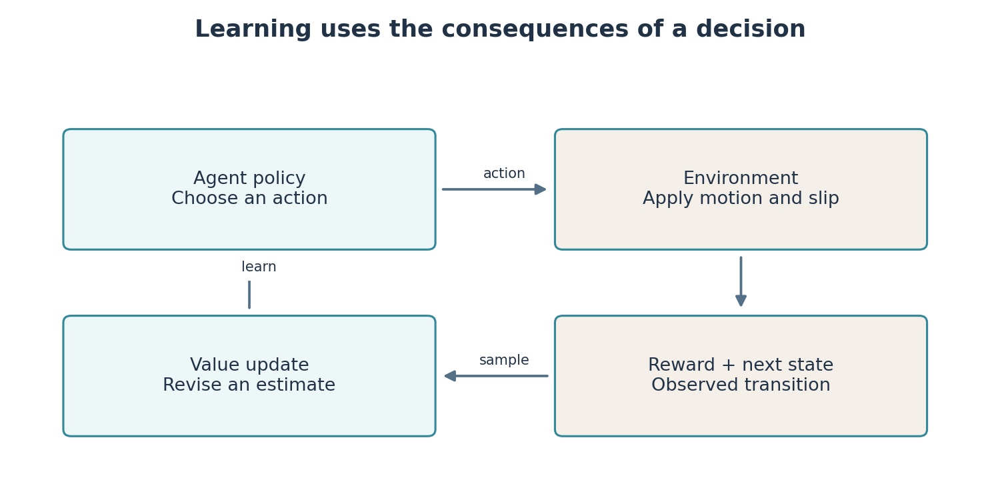
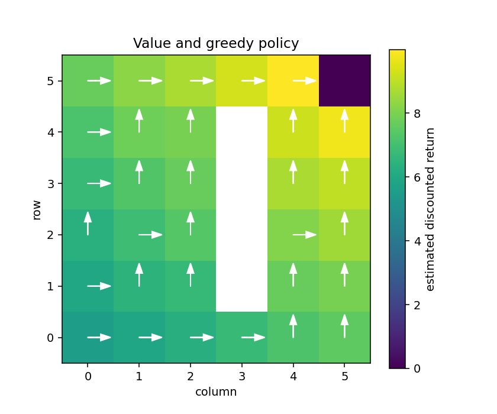

# Lab 6: Learn a navigation decision from experience

So far, you have written rules and supplied a map. **Reinforcement learning**, RL, asks a different question: can a decision rule improve through interaction and feedback? We start with a small grid robot so every number can be inspected. Neural networks are not needed yet.

**Your result:** a moving grid-robot replay, a table learned from experience and a comparison with a solution calculated from a known model. This lab introduces the concepts while you implement an update. It does not ask you to memorise algorithm names before seeing what they do.

## Describe one decision completely

The **agent** is the decision-making program. The **environment** is the world responding to its actions. At each step the agent observes the situation, chooses an action, receives a numerical reward, and sees what happened next. An **episode** is one complete attempt, ending at the goal or a chosen limit.

| Concept | In this lab | Later in the ROS robot |
|---|---|---|
| State | Grid cell occupied by the robot | Full physical state, generally not directly available |
| Observation | The same cell index | Laser measurements, relative goal and measured velocity |
| Action | East, north, west or south | A velocity choice or a pair of continuous commands |
| Reward | Goal reward minus movement/collision penalties | A numerical rule based on progress and outcomes |
| Policy | Which action to choose in each cell | A function from observations to commands |
| Transition | Probability of reaching another cell after an action | Motion, sensing and disturbances |

In a **Markov decision process**, the state contains enough information to predict the distribution of the next state and reward given the action. Our grid cell has this property under the defined model. One laser scan on a moving robot often does not: hidden obstacles, moving people and unobserved velocity can matter. That is partial observability. We will distinguish the physical state from the limited observation supplied to a learned policy.

The grid robot usually moves in the requested direction, but sometimes slips sideways. The code's `slip=0.1` means a total 10% probability of a perpendicular action, split equally between the two sides. A blocked movement leaves the robot in its current cell and gives a penalty. Reaching the goal ends the task.



## Why immediate reward is not enough

Moving toward the goal can require a detour. We therefore consider **return**, the sum of future rewards. With discount factor $\gamma$:

$$G_t=r_{t+1}+\gamma r_{t+2}+\gamma^2r_{t+3}+\cdots.$$

The subscript $t$ means the current decision time. A factor below one gives less weight to distant rewards. With rewards 1 now and 2 on the next step and $\gamma=0.9$, the return is $1+0.9\times2=2.8$. Discounting is part of the learning objective; it is not a measure of confidence in a sensor.

The **value** $V(s)$ is expected future return from a state under a specified policy. **Action value** $Q(s,a)$ is expected return after choosing action $a$ in state $s$ and then following the policy. Expected means an average over possible outcomes, including slips.

## Solve the small problem when the model is available

Dynamic programming uses the transition model directly. **Value iteration** repeatedly asks, for every state, which action has the largest expected immediate reward plus discounted next-state value. **Policy iteration** alternates two tasks: evaluate the current policy, then improve its action choices using those values.

```bash
python3 -m teaching.tabular --method value --out results/lab06_value
python3 -m teaching.tabular --method policy --out results/lab06_policy
```

Open `replay.html` and `policy.png` in each folder. The arrows show greedy actions; colour shows estimated value. Both methods use the same known model. Equal-valued alternatives may give different arrows while achieving the same value. Inspect `GridRobot.transitions`, `action_values`, `value_iteration` and `policy_iteration` in `teaching/tabular.py`.

These methods are useful here as a reference answer. Calling them model-free learning would be incorrect because they explicitly use transition probabilities.

## Learn when only sampled experience is available

**Q-learning** updates a table after observing one transition:

$$Q(s,a)\leftarrow Q(s,a)+\alpha\left[y-Q(s,a)\right],$$
$$y=r+\gamma(1-d)\max_{a'}Q(s',a').$$

Here $s'$ is the next state; $a'$ ranges over its possible actions; $d$ is 1 for a true terminal transition and 0 otherwise. The target $y$ combines observed reward and an estimate of future return. The difference $y-Q(s,a)$ is the **temporal-difference error**. The learning rate $\alpha$ controls how much of that difference is applied now.

For current value 2, reward 1, best next value 4, $\gamma=0.9$ and $\alpha=0.2$, the nonterminal target is 4.6 and the updated entry is $2+0.2(4.6-2)=2.52$. If the transition ends the task, the target is just 1 and the updated entry is 1.8. A terminal goal has no later decision from which to collect another reward.

**You write** `q_update` in `starters/lab06/q_update_skeleton.py`. Update exactly the selected table entry in place and return the target. Then make the running experiment use your code:

```bash
ARC_TABULAR=starters.lab06.q_update_skeleton python3 -m teaching.tabular --method q --episodes 3000 --out results/lab06_student
```

To compare with the supplied reference, run without the selector:

```bash
python3 -m teaching.tabular --method q --episodes 3000 --seed 0 --out results/lab06_q
```

This produces `q.npy`, `policy.npy`, `returns.csv`, a learning plot and a replay. NumPy's `.npy` files store arrays; they are generated results, not source files to edit by hand.

## Learning needs exploration

If the agent always chooses its currently highest-valued action, an early mistake can prevent it from discovering a better route. **Epsilon-greedy exploration** chooses a random action with probability $\epsilon$, otherwise the largest current Q value. The code reduces epsilon during training but keeps a small exploratory probability.

Q-learning is **off-policy**: its update targets the greedy next action even while the behaviour used to collect experience is exploratory. This differs from evaluating the exact exploratory behaviour policy.

Evaluation uses greedy actions and a separate random-number stream for slips. Do not compare a noisy training return directly with deterministic policy quality. Repeat complete training runs with different seeds to assess variation. More episodes may help, but one successful seed does not establish general reliability.



## Follow Lab 6 from training to Gazebo

The lab has **three separate displays**. **Pygame** shows the Q-table changing during training. The saved **`replay.html`** shows one evaluation run of the grid policy after training. **Gazebo** uses the saved Q-table to move a wheeled ROS robot in a matching grid world. The Gazebo demonstration does not retrain the policy.

### Step 1: Prepare a terminal inside Ubuntu

```bash
source /opt/ros/jazzy/setup.bash
source ~/arc_ws/install/setup.bash
cd ~/arc_ws/src/arc-course
python3 -c "from teaching.tabular import GridRobot; print(GridRobot().n_states)"
```

The first two `source` commands load ROS and the course packages into **this terminal**. `cd` selects the repository so Python finds `teaching.tabular` and experiment results are saved in the correct place. The final command prints **36** (the grid has 6 × 6 states). The grid experiment is pure Python, but we prepare ROS now for the later deployment.

To show training visually, install Pygame once:

```bash
sudo apt update
sudo apt install -y python3-pygame
python3 -c "import pygame; print(pygame.version.ver)"
```

The version command confirms the **current Python interpreter** can import Pygame. If it fails inside a private virtual environment, use one that can see system-site packages or install Pygame into that environment. The `--live` option requires a graphical desktop.

### Step 2: Run the model-based references

```bash
python3 -m teaching.tabular --method value --out results/lab06_value
python3 -m teaching.tabular --method policy --out results/lab06_policy
```

`python3 -m` runs a Python module, `--method` selects the algorithm, and `--out` specifies a new results folder. Value and policy iteration use the environment's **known transition probabilities**. They are useful reference solutions, but they do **not** learn by sampling experience.

### Step 3: Train Q-learning and watch the table change

```bash
python3 -m teaching.tabular --method q --episodes 3000 --seed 0 --live --out results/lab06_live
```

| Option | Meaning |
|---|---|
| `--method q` | Use Q-learning and update Q-values from sampled transitions |
| `--episodes 3000` | Train for 3,000 attempts; each attempt restarts the grid robot |
| `--seed 0` | Fix the pseudorandom sequence to reproduce this example |
| `--live` | Open the Pygame training window |
| `--out results/lab06_live` | Save tables, plots, evaluation report and replay in a **new** folder |

The **blue dot** shows the resulting grid cell. **Orange** marks the Q-entry updated on the latest step. **Green** marks the current best action in a cell. Read the side panel: episode, epsilon, previous cell, chosen action, next cell, reward, target, old Q and new Q. The actual movement may differ from the chosen action because the training world includes random slip.

Press **Space** to pause or resume, **F** to switch slow/fast updates, and **Esc** to close the viewer while training continues. When training finishes, the window closes and the terminal prints an evaluation summary, including successes out of 100 trials. **This training happens in Python/Pygame, not Gazebo.**

<!-- IMAGE SLOT: insert the lecturer's screenshot of the live Pygame Q-table here after the image file is available. -->

### Step 4: Inspect and replay the trained policy

```bash
cat results/lab06_live/report.json
xdg-open results/lab06_live/learning.png
xdg-open results/lab06_live/policy.png
xdg-open results/lab06_live/replay.html
```

`cat` prints the evaluation report. `xdg-open` opens images or a browser. **learning.png** plots smoothed training episode returns; **policy.png** shows the greedy action arrows and values. **replay.html** animates one **post-training evaluation** in the Python grid, not the live learning updates and not Gazebo.

The saved `q.npy` is the learned Q-table with 36 rows and 4 actions per row; `policy.npy` stores a selected action per state. These are **generated outputs**, not files to edit by hand.

### Step 5: Run your own Q-learning update

Complete `q_update` in the student source file:

```bash
nano starters/lab06/q_update_skeleton.py
```

It must update only `q[state, action]` in place, and return the TD target. Then run your implementation:

```bash
ARC_TABULAR=starters.lab06.q_update_skeleton python3 -m teaching.tabular --method q --episodes 3000 --seed 0 --live --out results/lab06_student_live
```

`ARC_TABULAR=...` selects the student implementation for this command. Compare the output with the reference run. A `NotImplementedError` indicates the placeholder is still present.

### Step 6: Deploy the saved Q-table in Gazebo

Stop other Gazebo, Nav2, and teleoperation sessions so they do not compete on `/cmd_vel`. Build the two ROS packages, clean old processes and return to the repository:

```bash
cd ~/arc_ws
colcon build --symlink-install --packages-select arc_gazebo arc_course
source install/setup.bash
arc-clean
cd ~/arc_ws/src/arc-course
export PYTHONPATH="$PWD:$PYTHONPATH"
```

`colcon build` installs the new Gazebo launch, the matching grid world and the policy driver. `arc-clean` stops previous course processes. `PYTHONPATH` ensures the driver can import `teaching.tabular_motion` from the source repository.

Run the reference table from Step 3:

```bash
ros2 launch arc_course lab06_gazebo.launch.py q_table:="$PWD/results/lab06_live/q.npy"
```

This command launches the matching Gazebo grid, spawns the robot, activates its controllers and loads the Q-table using `grid_policy_driver`. A greedy Q-table action chooses east, north, west or south; **supplied** ROS motion logic uses `/odom` to turn and drive toward the next cell and publishes commands to `/cmd_vel`. The terminal prints cell/direction updates and, on success, **Goal reached**. Stop the launch with **Ctrl+C**.

For a VM that struggles with Gazebo graphics, use:

```bash
ros2 launch arc_course lab06_gazebo.launch.py q_table:="$PWD/results/lab06_live/q.npy" headless:=true
```

This runs Gazebo without its window. It still needs a working simulator and controllers. You may also point `q_table:=` to `results/lab06_student_live/q.npy` after training your own update. A table trained for 6 × 6 cells is **not** a general navigation policy for an unknown map. Gazebo does not reproduce the training grid's injected random slip, and this fixed-policy demo does not train with LiDAR.

<!-- IMAGE SLOT: insert the lecturer's screenshot of the Q-table policy running in Gazebo here after the image file is available. -->

### Step 7: Inspect the ROS side and diagnose failures

While Gazebo is running, open a **second** Ubuntu terminal:

```bash
source /opt/ros/jazzy/setup.bash
source ~/arc_ws/install/setup.bash
ros2 node list
ros2 topic info /cmd_vel --verbose
ros2 topic echo /odom --once
```

The first command lists running nodes; look for `grid_policy_driver`. The topic info command shows who publishes and subscribes to `/cmd_vel`. The odometry command shows one measured robot pose. If the driver reports a missing subscription, stale odometry, invalid Q-table, blocked action or looping policy, use the error to diagnose the cause rather than starting more command publishers.

**Every training run requires a new output folder.** The script rejects an existing `--out` directory to protect earlier results. For example, use `results/lab06_second` and deploy its corresponding `q.npy`.

After Step 6 has built the ROS packages, you can hand off from training to Gazebo in one terminal:

```bash
python3 -m teaching.tabular --method q --episodes 3000 --seed 0 --live --out results/lab06_handoff &&
ros2 launch arc_course lab06_gazebo.launch.py q_table:="$PWD/results/lab06_handoff/q.npy"
```

`&&` runs the second command only if training completes successfully. Compare three outcomes: **training updates in Pygame**, **saved numerical replay**, and **actual wheeled movement in Gazebo**. Which decisions were learned, and which physical control rules were supplied by the course?

## A time limit is not always a terminal state

The Q-learning collector stops an attempt after 150 steps to avoid an endless training loop. Here that is an external collection limit. The underlying navigation task could continue, so the final stored transition still bootstraps from its next state. A true goal transition does not bootstrap.

Gymnasium later represents this distinction as `terminated` and `truncated`. If a finite deadline is part of the task itself, it belongs in the problem definition, and remaining time may need to be included in the state. Do not blindly set every “episode ended” flag to terminal.

## Connect this to robot software

RL does not replace ROS messages. ROS carries observations into a policy and carries chosen commands out. In Lab 6 we train separately so you can inspect each table entry, then try the fixed grid policy in Gazebo. Lab 7 introduces continuous robot observations, and Lab 9 connects policies that use live sensor observations to ROS. Do not publish grid actions as `Twist` values; “north” is a grid transition, not a body-frame wheel command.

Your investigation is to vary slip or the movement penalty, retrain, and explain the resulting policy using the objective. A reward is a design choice, not an automatic definition of good behaviour. A robot can earn reward in an unintended way, so report goal completion and failed attempts separately from return.

## Files and reading

| File | Role |
|---|---|
| `starters/lab06/q_update_skeleton.py` | Your update implementation |
| `teaching/tabular.py` | Environment, reference algorithms and experiment driver |
| `teaching/tabular_view.py` | Optional Pygame view of the training updates |
| `teaching/tabular_motion.py` | Controller that turns a grid action into motion toward a cell |
| `arc_course/arc_course/grid_policy_driver.py` | ROS node that loads the table and drives the simulated robot |
| `arc_gazebo/worlds/lab06_grid.sdf` | Matching Gazebo world for the deployment demo |
| `results/lab06_q` | Generated tables, curves, replay and evaluation report |

- Sutton and Barto, *Reinforcement Learning: An Introduction*, second edition, Chapters 3, 4 and 6. [Author's book page](https://incompleteideas.net/book/the-book-2nd.html).
- [Gymnasium: handling time limits](https://gymnasium.farama.org/main/tutorials/handling_time_limits/) explains why terminal transitions and external truncations need different targets.
